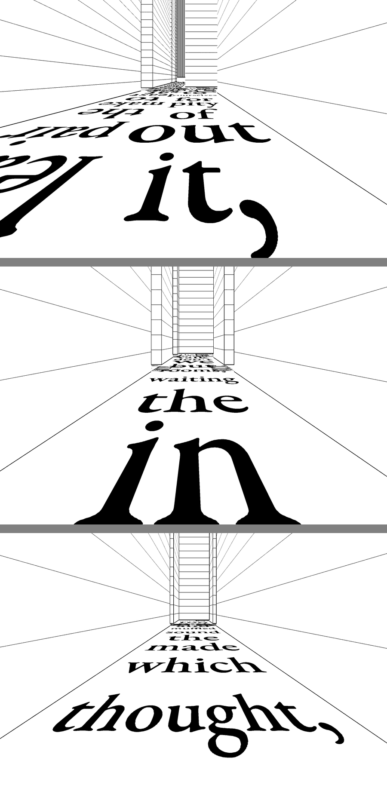

# Plan: Typographic Mazes as a book

An A5 book printed in 1-bit black and white. Each literary work becomes a
**maze drawing**:

- One stroke per sentence. The stroke is as long as the sentence has words.
- At each sentence the path turns by the sign of that sentence's sentiment
  (negative turns one way, positive the other, neutral goes straight).

The book treats these drawings as an established method of literary analysis:
it zooms into regions of each drawing, explains them, and compares books,
authors and themes. It is typeset in LaTeX.

---

## 1. Engine (replaces `main.py` / `draw.py`)

Pipeline: `ingest → segment → score → walk → fit → render → annotate → analyse`

| Step | What it does |
|---|---|
| ingest | Fetches the Gutenberg text, strips the licence header/footer, detects chapter headings |
| segment | Splits into sentences (and paragraphs). The unit can be word, sentence or paragraph; sentence is the default |
| score | Scores sentiment with AFINN (pluggable). Turn = sign(score), with an optional dead zone `|score| < τ → straight` |
| walk | Pure geometry. Every vertex is a sentence: `{i, x, y, heading, turn, len, chapter, para, char_offset, score}` → `walk.parquet` |
| fit | Fits the drawing to the A5 text block: uniform scale, long side vertical, a margin band kept free for labels. Two modes: `fit` (fill the page) and `common` (same mm-per-word across books) |
| render | Writes a vector PDF: pure black, stroke ≥ 0.1 pt, no grey |
| annotate | Anchors → labels and arrows (§3) |
| analyse | All the metrics in §2 → `metrics.json` plus LaTeX macros |

Each book has a config file `books/<slug>.yaml` with the source, author,
translator, themes, terms to track, and labels or zoom regions to force.

The old word-by-word renderer stays available as `--unit word`.

---

## 2. The analysis methods

The book presents these as the standard toolkit of **labyrinthography**: the
study of a text through the path its sentences trace. Each method is
computable from `walk.parquet`, and each is reported against a **shuffle
baseline**: 200 redraws of the same book with its sentences shuffled, giving a
z-score. Through that baseline, any reading in the book is backed by a number.

**Don't invent citations.** The established tone comes from the voice, not
from fictional scholars, journals or invented quotes attributed to real people.

### 2.1 Global measures (the "vital signs" of a book)

| Method | Symbol | Definition | Reading |
|---|---|---|---|
| **Stride** | σ̄, σ_cv | Mean and coefficient of variation of stroke length (words per sentence) | Clipped versus periodic prose; a high CV means the book alternates breath |
| **Drift** | Δ | ‖end − start‖ / total path length | ≈0: a book that returns home (cyclical). High: a book that departs (picaresque, voyage) |
| **Handedness** | Θ | Net rotation = Σ turns × 90°, in full turns | Sinistral (net dark) versus dextral (net light) books; ≈0 = balanced |
| **Turn entropy** | H₁, H₂ | Shannon entropy of the L/S/R sequence, and conditional entropy on the previous turn | Emotional predictability; low H₂ = the book has a rhythm |
| **Recoil rate** | ρ | Share of consecutive same-direction turns (LL, RR = a 180° reversal) | Doubling back: a mood that intensifies |
| **Vacillation rate** | ν | Share of LR / RL pairs (staircase pattern) | Ambivalence; the path zig-zags forward |
| **Corridor spectrum** | κ | Distribution of runs of neutral sentences (straightaways); its tail exponent | Long corridors = exposition, description, procedure |
| **Sprawl** | S | Ink area / convex hull area | Dense, compact books versus sprawling ones |
| **Texture** | D_f | Box-counting fractal dimension of the drawing | Visual complexity; 1 = line-like, → 2 = fills the plane |
| **Gyration curve** | R_g(t) | Radius of gyration of sentences 0..t, against narrative time t ∈ [0,1] | Expanding versus contracting narratives; where the book "opens up" |
| **Bearing profile** | B | Share of strokes heading N/E/S/W relative to the opening heading | A compass rose of the book |

### 2.2 Local structures (regions you can point at)

These are detected automatically, ranked, and turned into anchors and zooms.

| Structure | Detection | Reading |
|---|---|---|
| **Knot** | Peaks of self-crossing density (crossings per mm² in a sliding window) | Rumination: the text circles a subject without leaving |
| **Chamber** | Closed faces of the path's planar graph (polygonize the self-intersections); area and number of sentences on the boundary | A passage that encloses a space and seals it off |
| **Corridor** | Maximal straight runs above a length threshold | Uninterrupted neutral passages |
| **Switchback** | Windows with high ν | Indecision, dialogue back-and-forth |
| **Spiral** | Windows of monotone rotation (≥ 3 same-direction turns within k sentences) | Descent (sinistral) or ascent (dextral) |
| **Return** | Sentence j passes within ε mm of sentence i, with j − i > N | The book revisits old ground; listed as pairs, with both sentences quoted |
| **Frontier** | Sentences that set a new hull extreme | Moments that push the book into new territory |

### 2.3 Time and space together

- **Recurrence plot**: an N×N 1-bit matrix with a black dot where sentences i and j
  are within ε of each other. Diagonal bands mean returns, blocks mean knots.
  It looks good in 1-bit.
- **Chapter territories**: the hull of each chapter, plus the Jaccard overlap
  between chapters, giving an adjacency matrix of which chapters share ground.
- **Footprints**: the vertices of sentences that mention a term (character, place,
  motif), with their centroid, spread and cluster outlines. **Co-territory**
  is the footprint overlap between two terms: do K. and the Court occupy the
  same ground?
- **Event stripe**: a 1-bit timeline strip (0 → 1) showing knots, chambers,
  corridors and spirals. Stripes from all books stack into a comparison chart
  of *when* in a book things happen.

### 2.4 Crossings, overlaps and enclosed areas

The path crosses itself constantly, and in places it piles up into very dense
tangles. That tangle is the most important material in the drawing, so it
gets its own methods.

The walk is axis-aligned with whole-word lengths, so every crossing sits on
**exact integer coordinates**. The whole planar structure can be computed
exactly, with no tolerance issues.

Prototype numbers (`prototypes/crossings.py`):

| Work | Sentences | Crossings | Median gap between crossing sentences | Overlapping (collinear) length |
|---|---|---|---|---|
| The Trial | 3,835 | 1,179 | 38 sentences | 916 words |
| Metamorphosis | 764 | 220 | 59 | 182 |
| Yellow Wallpaper | 376 | 115 | 21 | 148 |

| Method | Definition | Reading |
|---|---|---|
| **Crossing count / rate** | Proper crossings, total and per sentence | How tangled the book is |
| **Crossing gap** | Distribution of \|i − j\| over crossing pairs, split into short gaps (local knots) and long gaps (the book cutting across its own past) | Short-term rumination versus long-range return |
| **Junction order** | How many strokes meet at a lattice point (2 = crossing, 3+ = junction) | Points where several moments of the book meet |
| **Palimpsest** | Collinear overlap: stretches where a later sentence runs exactly on top of an earlier one; length, count, and the sentence pairs | The book rewrites itself; both sentences quoted side by side |
| **Crossing graph** | Sentences are nodes, crossings are edges; degree and betweenness | The **most-crossed sentence** is the book's hub (The Trial: #693, crossed 13 times, from the court hall scene). It's a natural label anchor and pull quote |
| **Cellularity** | Faces of the planar arrangement: count, area distribution, smallest cells | How finely the book subdivides its space; the chambers from §2.2 are the large, sealed faces |
| **Tangle field** | Crossing density per mm², drawn in 1-bit as stipple (dot density) | A heat map without grey |

**Dense tangles.** Where crossings get too dense for the 2D drawing to resolve:

- **Cascade zoom**: ×1 → ×4 → ×16 inset frames, each smaller than the last.
- **Exploded view**: the tangle drawn as small multiples, one per narrative quarter.
  You see the knot assembled over time.
- **Ground view (§3b)**: walk into the tangle.

### 2.5 Comparative methods

- **Signature vector**: each book reduced to the global metrics, as z-scores
  against its own shuffle baseline.
- **Maze distance**: Euclidean distance between signatures, giving a
  dendrogram ("family tree") of all books, drawn in 1-bit.
- **Author signature**: the mean and spread across an author's books.
  **Theme centroid** is the same across a theme.
  **Author-versus-theme decomposition**: a two-way ANOVA-style split of each
  metric into an author effect and a theme effect, on the grid of works
  (§4). It asks which matters more: who writes, or what about.
- **Registered overlay**: drawings aligned at the start point with the opening
  heading up, overlaid at common scale. Shown as small multiples, because
  overlaying in 1-bit gets muddy.
- **Translator control**: Garnett (Dostoevsky, Tolstoy, Chekhov) against other
  translators of the same authors.

---

## 3. Labels, arrows and zooms (1-bit)

- **Anchors** come from §2.2 (top-ranked knots, chambers, returns and so on),
  plus structural anchors (start, end, chapter starts), plus forced anchors from
  the yaml.
- **Labels** go in the margin band as LaTeX text, so they use the book's own
  font. Placement: sort anchors by angle around the drawing's centroid, assign
  them to margin slots, and push them apart iteratively to minimise leader
  crossings.
- **Arrow rule**: an arrow is black, but **white where it overlaps black ink**.
  Implemented in vector with shapely:
  - `ink = union(stroke.buffer(w/2))`
  - draw `arrow − ink` in black
  - draw `arrow ∩ ink` in white

  Python writes the drawing plus the arrows as a PDF, and the label text
  positions as a TikZ overlay `.tex`.
- **Zoom insets**: a frame on the full drawing, with a magnified panel on the
  facing page or in a margin cut-out. In the zoom, strokes can be swapped for
  their **actual sentences** set along the path at a readable size. The reader
  sees what the line is made of.
- **Commentary**: for each zoom or label, the tool exports the sentence range
  and its metrics to `books/<slug>/regions/*.md`. The commentary is written
  from the actual sentences, so the explanations are grounded in the text.

---

## 3b. Ground view: walking the pathways

A second kind of image, used where the 2D drawing becomes too dense to read
(the tangles from §2.4) and at the book's key anchors.

**Model**
- **The text is the pathway.** Every sentence stroke is a corridor one word
  long per unit of length. Its words are written on the floor one after
  another, set across the corridor like road markings: upright as you walk
  forward, and slightly stretched along the walking direction to offset
  foreshortening.
- **Tall walls line both sides of every pathway.** They are infinitely tall,
  so there is no sky and no seeing over them.
- Where pathways cross, the corridors merge: the walkable space is the union of
  all corridors, and the walls are its boundary. A crossing appears as a side
  opening, and its sentence runs across your floor at right angles (visible on
  the left of the first frame of the prototype).
- Where sentences overlap on the same line (palimpsest), their words share
  the floor and print over each other.
- **The camera is always inside a pathway**, at eye height, looking along it in
  the reading direction. You read the sentence by walking forward.
- Because the walls are infinitely tall, what's visible is purely 2D: a ray
  hits the first wall in the floor plan. That makes rendering exact.

**Look (1-bit)**
- **Font**: EB Garamond (SIL Open Font License), semibold for the floor so it
  holds up in 1-bit. Words are set large: each word fills the width of its
  pathway.
- **Walls**: white, ruled with horizontal lines every 0.3 units of height, like
  lined paper. They converge to the vanishing point and are dropped where they
  would come too close together to print. Black verticals at corners and
  openings, a black line where wall meets floor.
- Text in the distance fades out by culling, not grey.
- **Formats**: a single view (one page), a 4–6 frame walk along a sentence, and a
  360° panorama at a junction across a spread.

**Where the camera goes** (automatic candidates, then picked by hand)
- A few words before a sentence ends, so the turn ahead is visible (the
  sentiment turn seen from the ground). Ranked by how many pathways cross the
  stretch ahead.
- On the most-crossed sentence.
- Inside a junction or a palimpsest.
- The 2D page marks every viewpoint with a small eye symbol and view cone,
  using the arrow rule (black, white over ink).

**Methods defined from the ground** (added to the toolkit)
- **Sightline count**: how many distinct sentences are visible from the
  viewpoint.
- **Vista**: how far you can see along the pathway before a wall.
- **Openings**: side openings per 10 words, which shows how porous a passage is.

**Final renderer**: vector. The floor maps to the image by a homography, so
glyph outlines (fontTools) are transformed exactly and stay sharp close to
the camera. Wall courses and edges are lines. The prototype
`prototypes/view3d.py` is a raster ray-marcher, for checking the look only.

---

## 4. Corpus: themes × authors (public domain, English)

| | Fear | Love | Alienation | Sea / journey | Crime / guilt |
|---|---|---|---|---|---|
| Poe | Fall of the House of Usher | | | Arthur Gordon Pym | Tell-Tale Heart |
| Stevenson | Jekyll & Hyde | | | Treasure Island | Markheim |
| Melville | | | Bartleby | Moby-Dick | |
| Dostoevsky (Garnett) | | | Notes from Underground | | Crime and Punishment |
| Tolstoy (Garnett) | | Anna Karenina | Death of Ivan Ilyich | | |
| Kafka | | | The Trial, Metamorphosis | | |
| Others | Frankenstein, Dracula, Yellow Wallpaper | Pride and Prejudice, Jane Eyre, Madame Bovary, The Awakening | | Heart of Darkness, 20,000 Leagues | |

Each work gets 200 shuffle baselines.

---

## 5. The book (LaTeX, A5, 1-bit)

- **Toolchain**: LuaLaTeX + `memoir` (A5 trim), `tikz` for the label overlays,
  `pgfplots` for charts (black only, using pattern and dash styles, never grey).
  Data comes in as generated macros (`\metric{trial}{drift}`) and CSV tables.
- **`make book`** runs the engine for every yaml, then the figures, then
  `latexmk`.
- **Structure**:
  1. *Front matter*: title, contents.
  2. *Introduction to labyrinthography*: the method on one paragraph, drawn
     large with readable sentences; then the toolkit (§2) as a field guide,
     one glyph-like example per structure.
  3. *Themes* (one chapter each). Per work:
     - spread A: metrics and a short essay | the full labelled drawing
     - spread B: two or three zoom panels with sentence-level text and commentary
     - spread C (where the drawing is too dense): crossing analysis (tangle field,
       hub sentence, palimpsests) | a ground view from inside the tangle;
       optionally a 360° panorama across a spread
     - the theme ends with a comparison spread (small multiples at common
       scale, event stripes, theme centroid)
  4. *Authors*: author signatures and cross-theme authors (Poe, Stevenson,
     Melville, Dostoevsky, Tolstoy), with the author-versus-theme decomposition.
  5. *Controls*: shuffle baselines, the translator test.
  6. *Atlas*: the dendrogram of all works, plus a full table of signatures.
  7. *Appendix*: definitions and formulas, sources, code, colophon.
- **Print**: pure black, at least 0.1 pt, fonts embedded; test print after the
  first finished spread.

---

## 6. Milestones

1. **Engine**: walk with sentence positions plus fitted PDF; The Trial on A5.
2. **Analysis core**: §2.1 metrics, shuffle baseline, knot/chamber/return detection.
3. **Annotation**: anchors, label placement, inverted arrows, zoom panels with
   sentence text. Deliverable: The Trial spread A + spread B as a LaTeX PDF.
4. **Crossings and ground view**: exact arrangement (crossings, overlaps, enclosed
   areas), crossing graph, vector ground-view renderer with viewpoint selection.
   Deliverable: The Trial spread C.
5. **Test print** on the target printer and paper, including the culling of small
   glyphs in the ground view.
6. **Corpus**: fetch and build all works; author and theme comparisons.
7. **Writing**: region commentary and essays per work, chapter introductions.
8. **Book**: full LaTeX build, proofing, final PDF.
