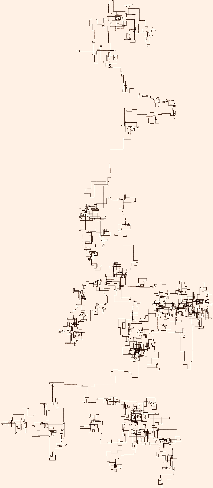
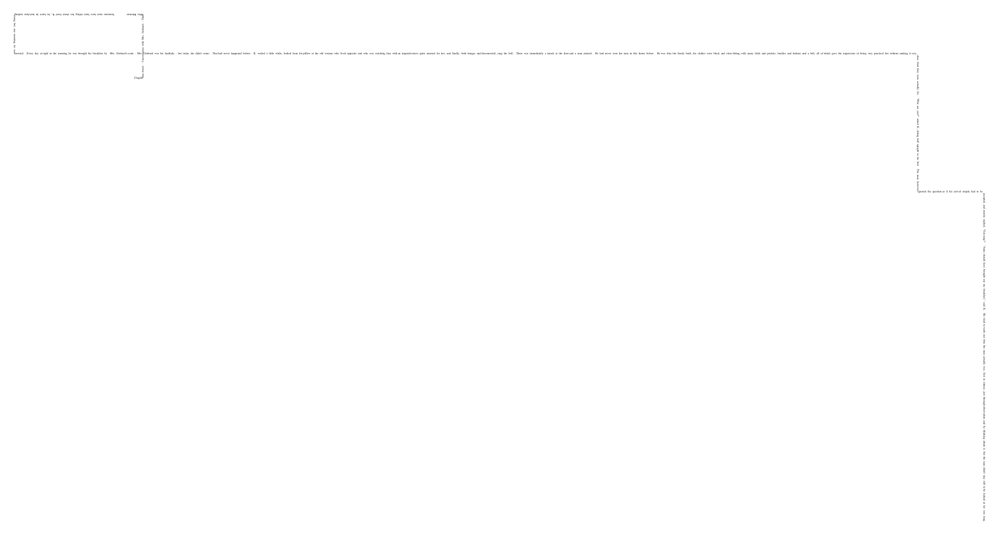

# make typographic art from books


<a href="https://www.buymeacoffee.com/sloev" target="_blank"></a>


uses sentiment of words to make turns

## dependencies

```
python 3+

brew reinstall cairo pkg-config

pip install cairocffi afinn

npm install svgexport -g

```

## usage

```
# get a text file with lots of text inside and run

python main.py input.txt

# now you have a huge output.svg
# create a portable downscaled PNG with correct ratio and max 1000 in width

svgexport output.svg output2.png 1000:
```

## here is Kafkas *The Trial* as a typographic maze:



And here is an excerpt showing that the lines actually are text:




## The engine (labyrinthography)

`labyrinth/` turns a Project Gutenberg text into the analysis and figures for the book, and `book/` typesets them with LuaLaTeX on A5.

```
pip install numpy shapely pycairo pyyaml
make            # = python3 -m labyrinth.build books/the-trial.yaml, then latexmk in book/
```

| Module | What it does |
|---|---|
| `labyrinth/text.py` | Fetches and cleans the text, detects chapters and subtitles, splits sentences (initials such as "K." and honorifics don't end a sentence) |
| `labyrinth/sentiment.py` | AFINN-165 sentence score → turn (left / straight / right) |
| `labyrinth/walk.py` | The 2D walk (exact integer geometry) and the 3D mineshaft (left turns tilt up, right turns tilt down) |
| `labyrinth/analysis.py` | Global measures, the shuffle baseline (z-scores, empirical p), crossings, palimpsests, knots, hub, return, coil, darkest passage, corridor, chapter overlap |
| `labyrinth/draw.py` | Vector PDFs, pure black: the labelled maze (arrows white where they cross ink), knot zooms, the mineshaft |
| `labyrinth/build.py` | Runs everything for one `books/*.yaml`, writes `build/<slug>/` including `numbers.tex`, so every number in the prose is generated |
| `book/` | `main.tex`, `methods.tex` (definitions and the test), `trial.tex` (The Trial), `labyrinth.sty` (A5 page design) |

`book/main.pdf` is the current specimen.
